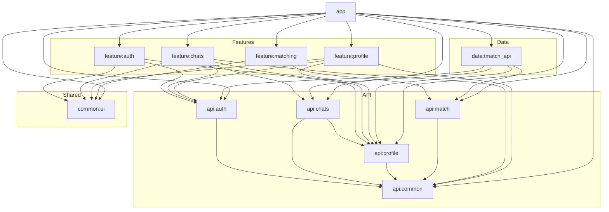

# Tmatch

`Tmatch` это Android-приложение, построенное на Kotlin, Jetpack Compose, Koin, Ktor и Firebase Cloud Messaging.

## Документация

- [Описание функционала и статуса интеграции](./docs/functional-overview.md)
- [Тестовые сценарии](./docs/test-scenarios.md)
- [Карта критериев](./docs/criteria-map.md)
- [Архитектурные решения](./ADR.md)

## Структура проекта

- `app` — точка входа приложения и сборка зависимостей.
- `api/*` — контракты домена, навигации и интеграционных gateway.
- `feature/*` — реализация пользовательских фич.
- `data/tmatch_api` — работа с backend API и локальным хранением, включая регистрацию FCM device token.
- `common/ui` — общие UI-компоненты и тема.

## Зависимости модулей

## Реализованные MVP-экраны

- `feature:matching` показывает ленту рекомендаций и входящие лайки.
- `feature:profile` покрывает собственный профиль и просмотр карточки пользователя.
- `feature:chats` покрывает список чатов, экран самого чата, локальный кэш сообщений и realtime-обновление через websocket stream.

Текущий backend-контракт чатов в MVP возвращает `other_user_card`, поэтому список чатов отображает имя и фото собеседника вместе с превью последнего сообщения. Данные чатов и сообщений кэшируются в Room, UI читает их через `Flow` из локальной БД, а экран чата поддерживает websocket stream для входящих сообщений и пагинированную догрузку истории через `GET /chats/{chat_id}/messages`. Unread-счётчики и read-status по-прежнему отсутствуют в контракте.

## Интеграции

- Firebase Cloud Messaging используется для получения push-сообщений.
- FCM device token регистрируется на backend через `POST /notifications/devices`.
- Входящие push-сообщения логируются и отображаются как системные уведомления; на Android 13+ показ зависит от разрешения `POST_NOTIFICATIONS`.

## APK

- Debug APK: `app/debug/app-debug.apk`
- Release APK: `app/release/app-release.apk`

## Архитектура

Описание принятых архитектурных решений находится в [ADR.md](./ADR.md).
